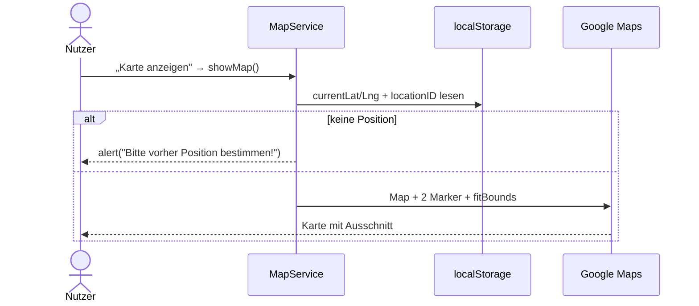

# IMPLEMENTATION.md — Feature 04: Karte

> **Für den KI-Agenten:** Schritt für Schritt abarbeiten, `[x]` abhaken, am Ende `BACKLOG.md` aktualisieren.

**Ziel:** Position + gewählte Attraktion auf einer Google-Karte anzeigen.
**Abhängigkeit:** 03-standort (Position im localStorage) + 01-attraktionen-laden (Detailseite)
**Verantwortlich:** [Name]
**Branch:** `feature/04-karte`

---

## Technische Übersicht

**Datei:** `assets/js/map.js` (`MapService.showMap`) — Marker **C4**, **C5** *(optional)*.
**Voraussetzung:** `currentLat`/`currentLng` aus `03-standort` im `localStorage`.
**Zwei Varianten (eine wählen):** **A) Google Maps** (API-Key) oder **B) Leaflet + OSM** (keyfrei, empfohlen zum Start).
**Prüfen:** Browser (Karte lädt, Marker sichtbar), siehe [`docs/setup.md`](../../docs/setup.md).



---

## Task 1: C4 — `showMap()` (Karte + Marker + Ausschnitt)

**Auftrag (Original-Marker):** „showMap vervollständigen: Karte einzeichnen, Marker setzen, Kartenausschnitt eingrenzen."

**Gemeinsam (beide Varianten):**
- [ ] Position-Guard: wenn `localStorage.getItem('currentLat') === null` → `alert('Bitte vorher Position bestimmen!')` + `return`.
- [ ] Punkte lesen: `currentPosition` aus `localStorage`, `locationPosition` aus `N8nService.getResponse()[locationID]`.
- [ ] `#mapOutput` braucht eine **Höhe** (CSS, z. B. `height: 400px`), sonst bleibt die Karte unsichtbar.

### Variante A — Google Maps (API-Key)
- [ ] `<script src="https://maps.googleapis.com/maps/api/js?key=DEIN_GOOGLE_MAPS_API_KEY…">` in `index.html` (eigenen Key, **nicht committen**).
- [ ] `new google.maps.Map(...)`; zwei `google.maps.Marker`; `LatLngBounds` + `map.fitBounds(bounds)`.

### Variante B — Leaflet + OpenStreetMap (keyfrei, empfohlen)
- [ ] In `index.html` (keine Keys): `<link rel="stylesheet" href="https://unpkg.com/leaflet/dist/leaflet.css">` + `<script src="https://unpkg.com/leaflet/dist/leaflet.js"></script>`.
- [ ] `showMap()` mit Leaflet umsetzen — einfache, vollständige Vorlage:

```js
showMap: function() {
    if (localStorage.getItem('currentLat') === null) {
        alert('Bitte vorher Position bestimmen!'); return;
    }
    const a   = N8nService.getResponse()[parseInt(localStorage.getItem('locationID'))];
    const cur = [parseFloat(localStorage.getItem('currentLat')), parseFloat(localStorage.getItem('currentLng'))];
    const loc = [parseFloat(a.Latitude), parseFloat(a.Longitude)];

    const map = L.map('mapOutput');
    L.tileLayer('https://{s}.tile.openstreetmap.org/{z}/{x}/{y}.png', {
        maxZoom: 19, attribution: '© OpenStreetMap-Mitwirkende'   // Attribution ist Pflicht (OSM-Policy)
    }).addTo(map);
    L.marker(cur).addTo(map).bindPopup('Akt. Position');
    L.marker(loc).addTo(map).bindPopup('Attraktion');
    map.fitBounds([cur, loc], { padding: [40, 40] });
}
```

- [ ] **Prüfen (Browser):** Detailseite → „Karte anzeigen" → Karte mit beiden Markern, Ausschnitt passt; bei Variante B **kein** Key/Netzwerk-401.
- [ ] **Commit:** `git commit -m "feat(karte): C4 showMap (Leaflet/OSM bzw. Google)"`

---

## Task 2 *(optional)*: C5 — Adresse via Geocoder

**Auftrag (Original-Marker):** „Postalische Adresse der aktuellen Pos. ermitteln und darstellen."

- [ ] **Variante A (Google):** `new google.maps.Geocoder()`; `geocode({ latLng: currentPosition }, ...)` → `results[0].formatted_address` in `#adressOutput`.
- [ ] **Variante B (keyfrei, Nominatim/OSM):** `fetch('https://nominatim.openstreetmap.org/reverse?format=json&lat=..&lon=..')` → `data.display_name` in `#adressOutput`. Achtung: Nominatim-Nutzungsrichtlinie (Rate-Limit, sinnvoller `Accept-Language`, kein Massen-Polling).
- [ ] **Prüfen:** Adresse erscheint unter der Karte.
- [ ] **Commit:** `git commit -m "feat(karte): C5 Adresse (Geocoder bzw. Nominatim, optional)"`

---

## Abschluss

- [ ] Marker C4 (und ggf. C5) umgesetzt
- [ ] Abnahmekriterien aus `FEATURE.md` im Browser geprüft (inkl. Position-Guard)
- [ ] `BACKLOG.md`: `04-karte` → `✅ fertig`
- [ ] Pull Request anlegen (`git push origin feature/04-karte`)
