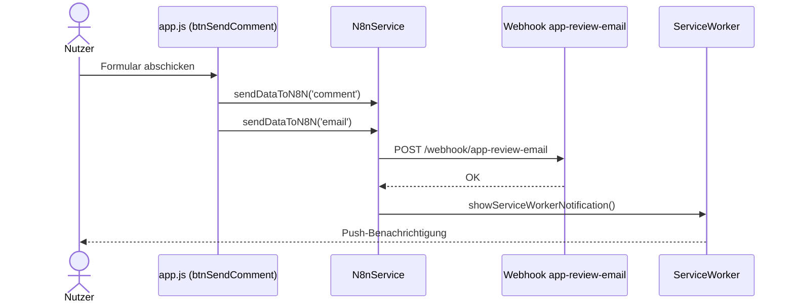

# IMPLEMENTATION.md — Feature 07: Bewertung per E-Mail + Push (D1+D4)

> **Für den KI-Agenten:** Schritt für Schritt abarbeiten, `[x]` abhaken, am Ende
> `BACKLOG.md` aktualisieren.

**Ziel:** Bewertung löst E-Mail an Betreiber aus + Push-Bestätigung auf dem Gerät.
**Abhängigkeit:** 02-bewertung-senden abgeschlossen
**Verantwortlich:** [Name]
**Branch:** `feature/07-feedback-mail`

---

## Technische Übersicht

**Dateien:** `assets/js/app.js` (Button-Handler `btnSendComment`), `assets/js/n8n.js`
(`sendDataToN8N`, `showServiceWorkerNotification` — beide bereits implementiert).
**Backend:** n8n-Vorlage `Vorlage-PWA-SendFeedbackMail` (unverdrahtet) duplizieren.
**Ablauf (Mermaid):** Konvention → [`docs/diagramme.md`](../../docs/diagramme.md) Abschnitt 5.

---

## Task 1: PWA-seitigen Aufruf aktivieren

- [ ] In `app.js`, Handler zu `btnSendComment`: Zeile
      `//N8nService.sendDataToN8N('email');` einkommentieren (oder gleichwertig ergänzen)
- [ ] **Prüfen (Browser, DevTools Network):** Formular abschicken löst zwei Requests
      aus (`add-comment` und `app-review-email`)

## Task 2: Vorlage-Workflow duplizieren + verdrahten

- [ ] `Vorlage-PWA-SendFeedbackMail` im n8n-Workspace duplizieren (eigene Kopie)
- [ ] Webhook → Set/Edit-Fields-Node (Felder `userName`, `userComment`, `formattedDate`
      aus `body.name`/`body.comment`/`body.timestamp`) → Send-Email-Node → Respond to
      Webhook verbinden
- [ ] Workflow aktivieren
- [ ] **Prüfen:** Testkommentar über die PWA abschicken → E-Mail trifft ein

## Task 3: Push-Bestätigung prüfen

- [ ] Im Browser Notification-Berechtigung erteilen
- [ ] Testkommentar abschicken → Push-Benachrichtigung erscheint nach erfolgreichem
      E-Mail-Versand
- [ ] Berechtigung verweigern → **Prüfen:** kein Absturz, nur Konsolen-Warnung
      („Notification-Berechtigung verweigert")
- [ ] **Commit:** `git commit -m "feat(feedback-mail): E-Mail-Benachrichtigung + Push aktiviert (D1+D4)"`

---

## Abschluss

- [ ] Abnahmekriterien aus `FEATURE.md` geprüft
- [ ] `BACKLOG.md`: `07-feedback-mail` → `✅ fertig`
- [ ] Pull Request anlegen (`git push origin feature/07-feedback-mail`)
