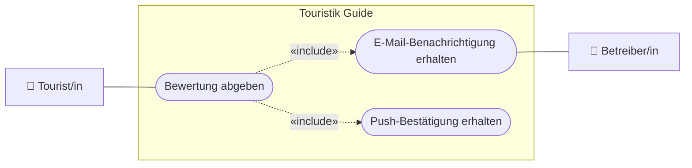

# USERSTORY.md — Nutzeranforderungen: 07-feedback-mail

> **Hinweis:** Konkretes LB3-Feature, **optionale Aufgaben D1 + D4** (aus der
> Musterlösung, Stufe D — `sendDataToN8N('email')` + `showServiceWorkerNotification()`
> in `assets/js/n8n.js`).

---

## Story 1 *(D1)* — Bewertung per E-Mail statt/zusätzlich zur Data Table

**Als** Betreiber/in des Touristik Guide
**möchte ich** bei einer neuen Bewertung sofort eine E-Mail erhalten
**damit** ich nicht aktiv in die Data Table schauen muss, um Feedback mitzubekommen.

### Abnahmekriterien

- Beim Abschicken des Bewertungsformulars wird zusätzlich zum bisherigen Speichern
  (`02-bewertung-senden`) eine E-Mail an den Betreiber ausgelöst
- Die E-Mail enthält Name, Kommentar und Zeitpunkt der Bewertung

---

## Story 2 *(D4)* — Bestätigung direkt auf dem Gerät

**Als** Tourist/in, die/der eine Bewertung abgeschickt hat
**möchte ich** eine Bestätigung direkt als Benachrichtigung auf meinem Gerät sehen
**damit** ich sicher bin, dass meine Bewertung angekommen ist — auch wenn ich die App
schon geschlossen habe.

### Abnahmekriterien

- Nach erfolgreichem E-Mail-Versand (Story 1) erscheint eine Service-Worker-Push-
  Benachrichtigung auf dem Gerät
- Ohne erteilte Notification-Berechtigung erscheint keine Fehlermeldung, nur ein
  Konsolen-Hinweis (kein Absturz)

---

## UseCase-Diagramm (UCD)

> Konvention: [`docs/diagramme.md`](../../docs/diagramme.md) (Abschnitt 1).

---

> **Einordnung:** Story 1 (D1) ist in der Musterlösung ein einziger, aktuell
> **auskommentierter** Aufruf (`//N8nService.sendDataToN8N('email');` in `app.js`,
> Funktion `btnSendComment`-Handler) — die Aufgabe ist, ihn zu aktivieren/ergänzen,
> nicht neuen Code zu schreiben. Story 2 (D4) ist vollständig implementiert und hängt
> an Story 1 (wird nur bei `type === 'email'` ausgelöst).
