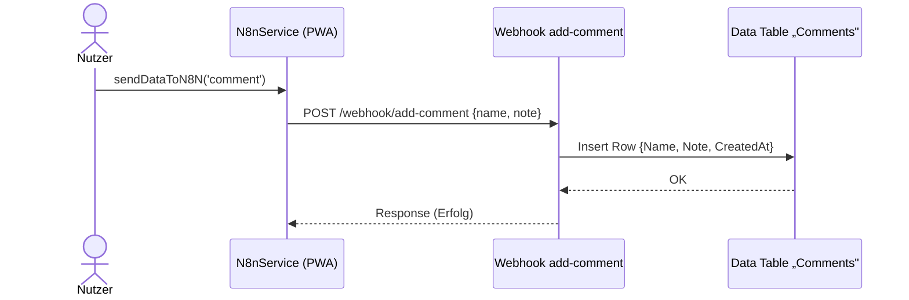

# IMPLEMENTATION.md — Feature 08: Datenhaltung (n8n Data Tables)

> **Für den KI-Agenten:** Schritt für Schritt abarbeiten, `[x]` abhaken, am Ende
> `BACKLOG.md` aktualisieren. **Diese Schritte passieren im n8n-Editor**, nicht im
> Code-Editor — es gibt keine Dateien in `assets/js/` zu ändern.

**Ziel:** Persistente Ablage für Attraktionen + Bewertungen über n8n Data Tables.
**Abhängigkeit:** 01-attraktionen-laden, 02-bewertung-senden abgeschlossen (Webhooks laufen)
**Verantwortlich:** [Name]
**Branch:** `feature/08-datenhaltung`

---

## Technische Übersicht

**Ort:** n8n-Workspace (Editor-UI + Data Tables), **nicht** `assets/js/`.
**Betroffene Workflows:** `get-attractions`, `add-comment` (Endpunkte aus `CONFIG.endpoints`
in `n8n.js`, unverändert).
**Ablauf `add-comment` mit Data Table (Mermaid):** Konvention → [`docs/diagramme.md`](../../docs/diagramme.md) Abschnitt 5.

---

> **Referenz-Setup:** Im edu-space-n8n-Workspace existieren die Data Tables `Attractions`
> und `Comments` bereits zentral (Musterlösung), und dazu passende **unverdrahtete
> Vorlage-Workflows** (`Vorlage-PWA-GetAttractions`, `Vorlage-PWA-AddComment`) — das
> n8n-seitige Gegenstück zu den `//------`-Markern im PWA-Code. Der Weg unten ist daher
> „Vorlage duplizieren + verdrahten", **nicht** „von Grund auf neu bauen".

## Task 1: Vorlage-Workflows duplizieren

- [ ] `Vorlage-PWA-GetAttractions` und `Vorlage-PWA-AddComment` im n8n-Workspace duplizieren
      (eigene Kopie pro Team, z. B. `<Team>-PWA-GetAttractions`)
- [ ] **Prüfen:** Beide Kopien sind inaktiv, Webhook-Node ist vorhanden, aber (noch) nicht
      mit dem Data-Table-Node verbunden — das ist der Ausgangszustand

## Task 2: `get-attractions`-Kopie verdrahten

- [ ] Im duplizierten Workflow: Webhook → Data-Table-Node (`operation: get`, `returnAll: true`)
      verbinden, als `dataTableId` die bestehende Tabelle `Attractions` auswählen → Data-Table-
      Node → `Respond to Webhook` (`respondWith: allIncomingItems`) verbinden
- [ ] Workflow aktivieren
- [ ] **Prüfen (Browser):** PWA lädt die Liste weiterhin korrekt (`getAttractions()` in
      `n8n.js` unverändert, ruft weiterhin `CONFIG.endpoints.getAttractions`)

## Task 3: `add-comment`-Kopie verdrahten

- [ ] Im duplizierten Workflow: Webhook → Data-Table-Node (`operation: insert`) verbinden,
      als `dataTableId` die bestehende Tabelle `Comments` auswählen, Spalten-Mapping
      `Name: {{ $json.body.name }}`, `Note: {{ $json.body.note }}` (Mapping-Mode
      **„Expression", nicht „Fixed"** — Sticky Note in der Vorlage weist explizit darauf hin)
      → `Respond to Webhook` verbinden
- [ ] Workflow aktivieren
- [ ] **Prüfen (Browser):** Bewertungsformular in der PWA abschicken → Erfolgsmeldung
      erscheint

## Task 4: Persistenz verifizieren

- [ ] Über die PWA einen Testkommentar abschicken
- [ ] In der Data Table `Comments` (n8n-UI) prüfen: neue Zeile mit den eingegebenen Werten
      ist vorhanden
- [ ] **Prüfen:** Workflow einmal deaktivieren/reaktivieren — Zeile bleibt erhalten
      (Data Tables sind unabhängig vom Workflow-Zustand persistent)
- [ ] **Commit:** `git commit -m "feat(datenhaltung): Vorlage-Workflows dupliziert + verdrahtet (Data Tables)"`
      (Commit dokumentiert die Umstellung — die eigentliche Änderung liegt im n8n-Workspace,
      nicht im Repo; ggf. Screenshot/Export der Workflow-Konfiguration beilegen)

---

## Abschluss

- [ ] Abnahmekriterien aus `FEATURE.md` geprüft (insb. Persistenz nach Neustart)
- [ ] `BACKLOG.md`: `08-datenhaltung` → `✅ fertig`
- [ ] Pull Request anlegen (`git push origin feature/08-datenhaltung`) — auch wenn keine
      Code-Dateien geändert wurden, dokumentiert der PR-Text die n8n-Workflow-Änderung
