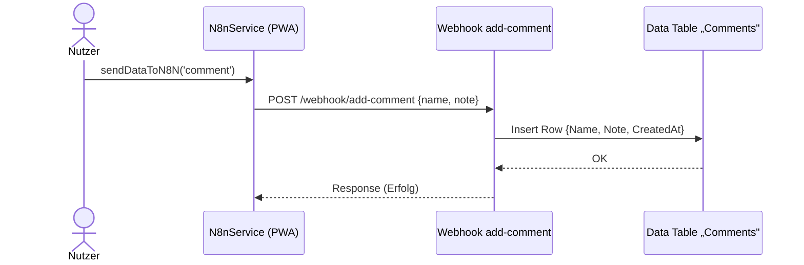

# IMPLEMENTATION.md — Feature 08: Datenhaltung (n8n Data Tables)

> **Für den KI-Agenten:** Schritt für Schritt abarbeiten, `[x]` abhaken, am Ende
> `BACKLOG.md` aktualisieren. **Diese Schritte passieren im n8n-Editor**, nicht im
> Code-Editor — es gibt keine Dateien in `assets/js/` zu ändern.

**Ziel:** Persistente Ablage für Attraktionen + Bewertungen über n8n Data Tables.
**Abhängigkeit:** 01-attraktionen-laden, 02-bewertung-senden abgeschlossen (Webhooks laufen)
**Verantwortlich:** [Name]
**Branch:** `feature/08-datenhaltung`

---

## Technische Übersicht

**Ort:** n8n-Workspace (Editor-UI + Data Tables), **nicht** `assets/js/`.
**Betroffene Workflows:** `get-attractions`, `add-comment` (Endpunkte aus `CONFIG.endpoints`
in `n8n.js`, unverändert).
**Ablauf `add-comment` mit Data Table (Mermaid):** Konvention → [`docs/diagramme.md`](../../docs/diagramme.md) Abschnitt 5.

---

## Task 1: Data Table „Attractions" anlegen

- [ ] In n8n: neue Data Table `Attractions` mit Spalten `AttractionID` (number), `Title`,
      `Description`, `Latitude`, `Longitude`, `Address`, `Telephone`, `Email`, `URL` (alle
      string, außer Latitude/Longitude als number)
- [ ] Bisherige Demodaten aus `stufen/*/assets/js/n8n.js` (`dbResponse`) als Startzeilen
      übertragen
- [ ] **Prüfen:** Tabelle enthält mindestens die bisherigen Demo-Attraktionen

## Task 2: `get-attractions`-Workflow umstellen

- [ ] Im Workflow hinter dem Webhook `get-attractions`: Data-Table-Node (`resource: row`,
      `operation: getRows`/`search`) auf `Attractions` einfügen, Ergebnis als Response
      zurückgeben (Format wie bisher: Array von Attraktions-Objekten)
- [ ] **Prüfen (Browser):** PWA lädt die Liste weiterhin korrekt (`getAttractions()` in
      `n8n.js` unverändert)

## Task 3: Data Table „Comments" anlegen

- [ ] Neue Data Table `Comments` mit Spalten `Name`, `Note`, `CreatedAt`
- [ ] **Prüfen:** Tabelle ist leer, aber mit korrektem Schema angelegt

## Task 4: `add-comment`-Workflow umstellen

- [ ] Im Workflow hinter dem Webhook `add-comment`: nach Empfang des Payloads
      (`name`, `note`) einen Data-Table-Node (`resource: row`, `operation: insert`) auf
      `Comments` einfügen, `CreatedAt` per n8n-Expression (`$now`) setzen
- [ ] Response an die PWA bleibt wie bisher (Erfolgsmeldung)
- [ ] **Prüfen (Browser):** Bewertungsformular in der PWA abschicken → Erfolgsmeldung
      erscheint

## Task 5: Persistenz verifizieren

- [ ] Nach Task 4: n8n-Workflow einmal deaktivieren/reaktivieren (oder n8n neu starten,
      falls möglich)
- [ ] **Prüfen:** die zuvor eingetragene Bewertung ist weiterhin in `Comments` vorhanden
- [ ] **Commit:** `git commit -m "feat(datenhaltung): n8n Data Tables für Attraktionen/Bewertungen"`
      (Commit dokumentiert die Umstellung — die eigentliche Änderung liegt im n8n-Workspace,
      nicht im Repo; ggf. Screenshot/Export der Workflow-Konfiguration beilegen)

---

## Abschluss

- [ ] Abnahmekriterien aus `FEATURE.md` geprüft (insb. Persistenz nach Neustart)
- [ ] `BACKLOG.md`: `08-datenhaltung` → `✅ fertig`
- [ ] Pull Request anlegen (`git push origin feature/08-datenhaltung`) — auch wenn keine
      Code-Dateien geändert wurden, dokumentiert der PR-Text die n8n-Workflow-Änderung
