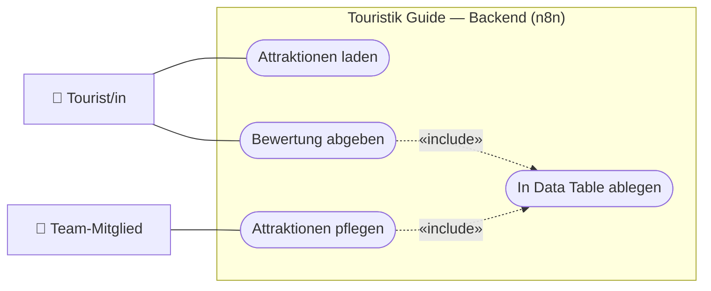

# USERSTORY.md — Nutzeranforderungen: 08-datenhaltung

> **Hinweis:** Konkretes LB3-Feature, **Mindestanforderung** (kein LB3-Stufenmarker —
> betrifft die n8n-Workflows hinter `get-attractions`/`add-comment`, nicht `assets/js/`).
> Details/Begründung: `ARCHITECTURE.md` → ADR-03.

---

## Story 1 — Bewertungen bleiben erhalten

**Als** Betreiber/in des Touristik Guide
**möchte ich** dass abgegebene Bewertungen dauerhaft gespeichert werden
**damit** sie einen n8n-Workflow-Neustart oder -Neu-Deploy überstehen und nicht verloren gehen.

### Abnahmekriterien

- Ein über die PWA abgeschickter Kommentar (`sendDataToN8N('comment')`) ist nach einem
  Neustart des n8n-Workflows weiterhin abrufbar
- Kein Datenverlust bei mehreren gleichzeitig eingehenden Bewertungen

---

## Story 2 — Attraktionsdaten zentral pflegen

**Als** Teammitglied
**möchte ich** die Attraktionsliste (Titel, Beschreibung, Koordinaten, Kontakt) an einer
Stelle pflegen können
**damit** ich sie nicht im Workflow-Code (Demodaten in `n8n.js`) hart codieren muss.

### Abnahmekriterien

- Die von `get-attractions` gelieferten Attraktionen stammen aus einer persistenten
  Tabelle, nicht aus statischen Demodaten im Workflow
- Neue/geänderte Attraktionen sind ohne Workflow-Codeänderung eintragbar

---

## UseCase-Diagramm (UCD)

> Konvention: [`docs/diagramme.md`](../../docs/diagramme.md) (Abschnitt 1).

---

> **Einordnung:** Dieses Feature ändert **keinen PWA-Frontend-Code** — `CONFIG.endpoints`
> in `assets/js/n8n.js` bleiben unverändert. Die Persistenz entsteht ausschließlich
> innerhalb der n8n-Workflows hinter `get-attractions`/`add-comment`.
