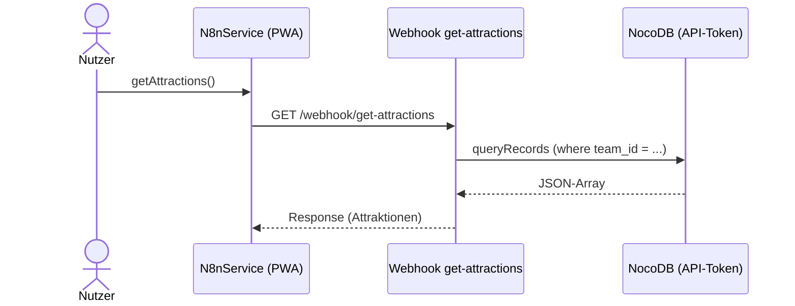

# IMPLEMENTATION.md — Feature 09: NocoDB (Bonus)

> **Für den KI-Agenten:** Schritt für Schritt abarbeiten, `[x]` abhaken, am Ende
> `BACKLOG.md` aktualisieren. **Diese Schritte passieren in NocoDB + n8n-Editor**, nicht
> im Code-Editor — es gibt keine Dateien in `assets/js/` zu ändern.

**Ziel:** NocoDB als Grid-UI + MCP-fähige Datenhaltung neben/statt den n8n Data Tables.
**Abhängigkeit:** 08-datenhaltung abgeschlossen
**Verantwortlich:** [Name]
**Branch:** `feature/09-nocodb`

---

## Technische Übersicht

**Ort:** NocoDB-Instanz + n8n-Workspace, **nicht** `assets/js/`.
**Credential-Typ:** „NocoDB API Token" (`nocoDbApiToken`) — **nicht** „NocoDB" (Login).
**Ablauf `get-attractions` mit NocoDB (Mermaid):** Konvention → [`docs/diagramme.md`](../../docs/diagramme.md) Abschnitt 5.

---

## Task 1: NocoDB-Base + Tabellen anlegen

- [ ] Owner meldet sich in NocoDB an, legt eine dedizierte Base für dieses Projekt an
      (keine bestehende Test-Base wiederverwenden)
- [ ] Tabellen `Attractions` und `Comments` mit dem Schema aus `08-datenhaltung`
      anlegen (bei geteilter Base zusätzlich Spalte `team_id`)
- [ ] **Prüfen:** Grid-Ansicht zeigt beide Tabellen korrekt an

## Task 2: Personal-API-Token erzeugen

- [ ] Owner-Account → NocoDB-GUI → Account → API-Tokens → neues Token erzeugen
- [ ] Token **nicht** in Chat/Dokumenten/Klartext-Dateien ablegen
- [ ] **Prüfen:** Token ist nur im n8n-Credential-Store hinterlegt

## Task 3: n8n-Credential anlegen

- [ ] In n8n: neues Credential vom Typ **„NocoDB API Token"** (`nocoDbApiToken`) mit dem
      Token aus Task 2 anlegen — **nicht** „NocoDB" (Login-Credential)
- [ ] **Prüfen:** Credential-Test in n8n erfolgreich

## Task 4: Workflows auf NocoDB umstellen

- [ ] Im Workflow hinter `get-attractions`: NocoDB-Node (`resource: row`,
      `operation: list`/`search`) auf `Attractions` einfügen (statt/zusätzlich zur
      Data-Table-Node aus `08`)
- [ ] Im Workflow hinter `add-comment`: NocoDB-Node (`resource: row`,
      `operation: create`) auf `Comments` einfügen
- [ ] **Prüfen (Browser):** PWA lädt Liste weiterhin korrekt, Bewertungsformular
      funktioniert weiterhin

## Task 5 *(nur bei geteilter Base)*: Datentrennung testen

- [ ] `where`-Filter im Workflow: `(team_id,eq,{{ $json.teamId }})`
- [ ] Mit zwei simulierten `team_id`-Werten durchspielen: je eigene Zeilen anlegen,
      abfragen, verifizieren dass keine Cross-Access-Ergebnisse zurückkommen
- [ ] **Prüfen:** Team A sieht nur Team-A-Daten, Team B nur Team-B-Daten

## Task 6: MCP-Zugriff verifizieren

- [ ] Über den NocoDB-MCP-Server (`queryRecords`/`getTableSchema`) dieselben Daten
      abfragen, die die PWA anzeigt
- [ ] **Commit:** `git commit -m "feat(nocodb): NocoDB als Bonus-Datenhaltung angebunden"`
      (Commit dokumentiert die Umstellung — die eigentliche Änderung liegt in
      NocoDB/n8n, nicht im Repo)

---

## Abschluss

- [ ] Abnahmekriterien aus `FEATURE.md` geprüft (insb. Datentrennung bei geteilter Base)
- [ ] `BACKLOG.md`: `09-nocodb` → `✅ fertig`
- [ ] Pull Request anlegen (`git push origin feature/09-nocodb`)
