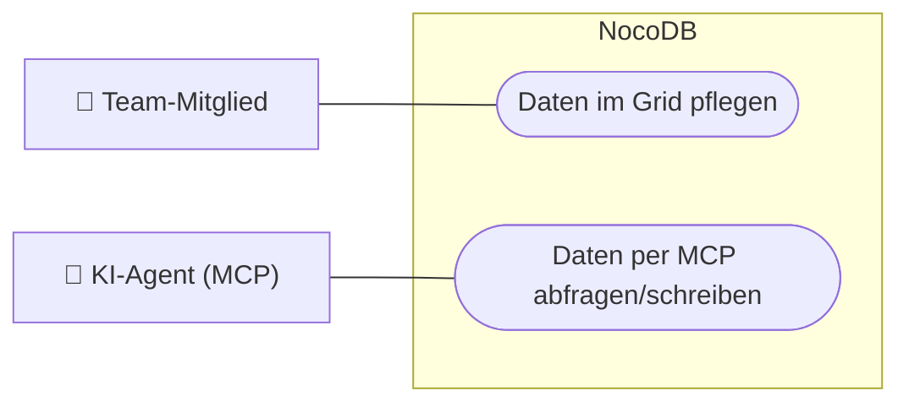

# USERSTORY.md — Nutzeranforderungen: 09-nocodb

> **Hinweis:** Bonus/optional — kein Kernumfang. Baut auf `08-datenhaltung` auf.
> Details/Begründung: `ARCHITECTURE.md` → ADR-03.

---

## Story 1 — Daten in einer Grid-Ansicht einsehen und pflegen

**Als** Teammitglied ohne n8n-Editor-Zugriff
**möchte ich** Attraktionen und Bewertungen in einer Tabellen-/Grid-Oberfläche ansehen
und bearbeiten können
**damit** ich nicht auf den n8n-Workspace angewiesen bin, um Projektdaten zu pflegen.

### Abnahmekriterien

- Attraktionen und Bewertungen sind in NocoDB als Tabellen mit Grid-Ansicht sichtbar
- Neue Attraktionen lassen sich direkt in NocoDB anlegen, ohne den Workflow zu ändern

---

## Story 2 *(zukunftsweisend)* — KI-Agent liest/schreibt Projektdaten strukturiert

**Als** Studierende/r, die/der mit einem KI-Agenten (MCP) arbeitet
**möchte ich** dass der Agent Attraktions-/Bewertungsdaten direkt abfragen und anlegen kann
**damit** ich beim Entwickeln und Testen nicht manuell zwischen PWA, n8n und einer
Datentabelle wechseln muss.

### Abnahmekriterien

- Der NocoDB-MCP-Server liefert Base-/Table-Schema und erlaubt `queryRecords`/
  `createRecords`/`updateRecords` auf den Projekttabellen
- Der Zugriff erfolgt über ein zentrales API-Token (kein Multi-User-Login nötig)

---

## UseCase-Diagramm (UCD)

> Konvention: [`docs/diagramme.md`](../../docs/diagramme.md) (Abschnitt 1).

---

> **Einordnung:** Wie bei `08-datenhaltung` ändert sich am **PWA-Frontend-Code** nichts.
> NocoDB tritt neben oder anstelle der n8n Data Tables als Datenhaltung an; die
> Webhook-Schnittstelle zur PWA bleibt gleich.
