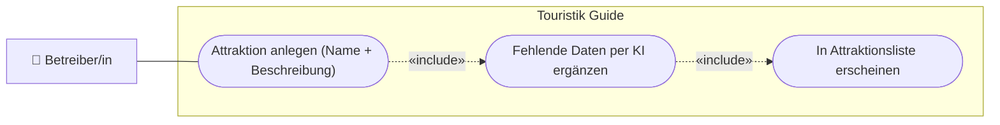

# USERSTORY.md — Nutzeranforderungen: 10-ki-attraktion-erstellen

> **Hinweis:** Konkretes LB3-Feature, **optionale Aufgabe D2** (Musterlösung, Stufe D —
> `sendDataToN8N('attraction')` in `assets/js/n8n.js`, Modal `modalAddAttraction`).

---

## Story 1 — Attraktion mit minimalem Aufwand anlegen

**Als** Betreiber/in des Touristik Guide
**möchte ich** eine neue Attraktion nur mit Name und Kurzbeschreibung anlegen können
**damit** ich nicht selbst Adresse, Koordinaten, Telefonnummer, E-Mail und Website
recherchieren und eintragen muss.

### Abnahmekriterien

- Im Formular „Attraktion hinzufügen" reichen Name + Kurzbeschreibung als Eingabe
- Die fehlenden Felder (Adresse, Koordinaten, Kontakt) werden automatisch ergänzt
- Die neue Attraktion erscheint danach in der normalen Attraktionsliste (`01-attraktionen-laden`)

---

## UseCase-Diagramm (UCD)

> Konvention: [`docs/diagramme.md`](../../docs/diagramme.md) (Abschnitt 1).

---

> **Einordnung:** Anders als `00`–`06` ist die PWA-Seite (Modal `modalAddAttraction`,
> Button `btnAddAttraction` → `sendDataToN8N('attraction')`) in der Musterlösung bereits
> vollständig fertig — die Lernaufgabe liegt ausschließlich im n8n-Backend
> (KI-Prompt + Data-Table-Schreiben verstehen und selbst verdrahten).
