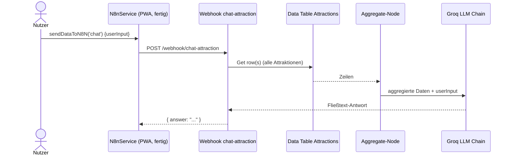

# IMPLEMENTATION.md — Feature 11: KI-Chat-Assistent über Attraktionen (D3)

> **Für den KI-Agenten:** Schritt für Schritt abarbeiten, `[x]` abhaken, am Ende
> `BACKLOG.md` aktualisieren. **Diese Schritte passieren im n8n-Editor** — die PWA-Seite
> (`index.html`, `n8n.js`) ist bereits fertig und wird nicht verändert.

**Ziel:** Freie Fragen zu Attraktionen per RAG-Chat beantworten.
**Abhängigkeit:** 01-attraktionen-laden abgeschlossen
**Verantwortlich:** [Name]
**Branch:** `feature/11-ki-chat-assistent`

> **Abweichung vom Muster der anderen Feature:** Anders als bei `08`/`07`/`10` existiert
> (Stand 2026-07-02) **keine unverdrahtete Vorlage** für diesen Workflow — nur die fertige
> Produktivversion `PWA-ChatAttraction`. Task 1 unten beschreibt daher „inspizieren +
> eigene Kopie ableiten" statt „Vorlage verdrahten". Falls eine echte Übungs-Vorlage
> (analog zu `Vorlage-PWA-*`) gewünscht ist, ist das ein separater Vorbereitungsschritt
> (s. `FEATURE.md` → Offene Fragen).

---

## Technische Übersicht

**Ort:** n8n-Workspace (`PWA-ChatAttraction` als Referenz), **nicht** `assets/js/`.
**Ablauf (Mermaid):** Konvention → [`docs/diagramme.md`](../../docs/diagramme.md) Abschnitt 5.

---

## Task 1: Referenz-Workflow inspizieren

- [ ] `PWA-ChatAttraction` im n8n-Workspace öffnen (read-only ansehen, nicht verändern —
      ist produktiv/aktiv)
- [ ] Aufbau nachvollziehen: Webhook → Data-Table „Get row(s)" (`Attractions`,
      `returnAll: true`) → Aggregate (`aggregateAllItemData`) → „Basic LLM Chain"
      (Groq `llama-3.1-8b-instant`, Prompt „Urlaubs-Assistent") → Respond to Webhook
      (`{ answer: $json.text }`)

## Task 2: Eigene Kopie anlegen (falls Team-Isolation gewünscht)

- [ ] `PWA-ChatAttraction` duplizieren (eigene Kopie, **nicht** die produktive Version
      verändern)
- [ ] In der Kopie: `dataTableId` ggf. auf eine eigene Attraktions-Tabelle umstellen,
      falls das Team nicht die geteilte `Attractions`-Table nutzen soll
- [ ] Workflow aktivieren, eigenen Webhook-Pfad notieren (falls abweichend von
      `chat-attraction`, `CONFIG.endpoints.chatAttraction` in der PWA entsprechend
      anpassen — sonst unverändert lassen)

## Task 3: End-to-End testen

- [ ] Chat-Modal öffnen, Frage zu einer bekannten Attraktion stellen
- [ ] **Prüfen:** Antwort erwähnt die richtige Attraktion mit plausiblen Details
- [ ] Frage zu etwas testen, das nicht in den Daten vorkommt
- [ ] **Prüfen:** Assistent gibt ehrlich zu, nichts Passendes zu finden (kein Erfinden)
- [ ] **Commit:** `git commit -m "feat(ki-chat): Chat-Assistent inspiziert/eigene Kopie verdrahtet (D3)"`

---

## Abschluss

- [ ] Abnahmekriterien aus `FEATURE.md` geprüft
- [ ] `BACKLOG.md`: `11-ki-chat-assistent` → `✅ fertig`
- [ ] Pull Request anlegen (`git push origin feature/11-ki-chat-assistent`)
