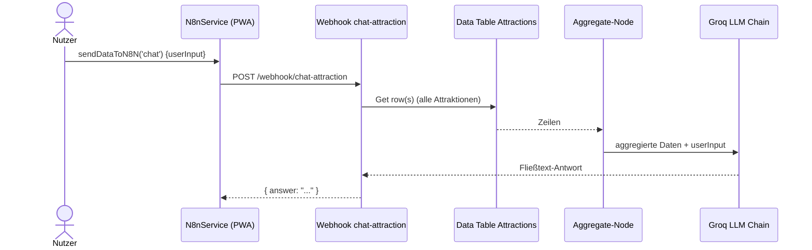

# IMPLEMENTATION.md — Feature 11: KI-Chat-Assistent über Attraktionen (D3)

> **Für den KI-Agenten:** Schritt für Schritt abarbeiten, `[x]` abhaken, am Ende
> `BACKLOG.md` aktualisieren. `index.html`/`app.js` sind bereits fertig verdrahtet;
> `n8n.js` braucht noch Task 1 (Marker D3 auflösen), der Rest passiert im n8n-Editor.

**Ziel:** Freie Fragen zu Attraktionen per RAG-Chat beantworten.
**Abhängigkeit:** 01-attraktionen-laden abgeschlossen
**Verantwortlich:** [Name]
**Branch:** `feature/11-ki-chat-assistent`

---

## Technische Übersicht

**Dateien:** `assets/js/n8n.js` (Marker D3), n8n-Workspace (`Vorlage-PWA-ChatAttraction`).
**Ablauf (Mermaid):** Konvention → [`docs/diagramme.md`](../../docs/diagramme.md) Abschnitt 5.

---

## Task 1: `n8n.js`-Marker D3 auflösen

- [ ] In `typeConfig`: Eintrag `'d3_chat_platzhalter'` in `'chat'` umbenennen, `ids` auf
      `['chatInput']` setzen (nur ein Feld, kein `msg` nötig)
- [ ] Im `switch`: `case 'd3_chat_platzhalter':` in `case 'chat':` umbenennen, Payload auf
      `{ userInput: val1.trim() }` setzen
- [ ] Im Erfolgsfall (Abschnitt „6. Erfolg"): Sonderfall `type === 'chat'` ergänzen —
      Antwort in `document.getElementById('chatOutput')` schreiben
      (`result.answer.replace(/\n/g, ' ')`) statt Eingabefelder zu überschreiben;
      `chatInput` danach leeren
- [ ] **Prüfen (Browser, DevTools Network):** Chat-Frage abschicken löst einen Request an
      `chat-attraction` aus (noch ohne Backend-Verdrahtung ggf. Fehler — folgt in Task 2/3)

## Task 2: Vorlage-Workflow duplizieren + Prompt ergänzen

- [ ] `Vorlage-PWA-ChatAttraction` im n8n-Workspace duplizieren (eigene Kopie)
- [ ] **Prüfen:** Webhook → Data-Table „Get row(s)" (`Attractions`) → Aggregate → „Basic
      LLM Chain" (Groq `llama-3.1-8b-instant`) → Respond to Webhook sind bereits verbunden;
      der Prompt-Text der LLM-Chain-Node ist **leer** (Platzhalter)
- [ ] Prompt ergänzen: Rolle „Urlaubs-Assistent", Auftrag „finde die zur Nutzerfrage
      passende Attraktion in den übergebenen Daten, antworte in Fließtext, erfinde nichts
      falls keine passt"; Daten (`{{ JSON.stringify($json.data) }}`) und Nutzerfrage
      (`{{ $('Webhook1').item.json.body.userInput }}`) im Prompt referenzieren
- [ ] Workflow aktivieren

## Task 3: End-to-End testen

- [ ] Chat-Modal öffnen, Frage zu einer bekannten Attraktion stellen
- [ ] **Prüfen:** Antwort erwähnt die richtige Attraktion mit plausiblen Details
- [ ] Frage zu etwas testen, das nicht in den Daten vorkommt
- [ ] **Prüfen:** Assistent gibt ehrlich zu, nichts Passendes zu finden (kein Erfinden)
- [ ] Mehrere Fragen nacheinander stellen → **Prüfen:** Inputfeld wird nach jeder Antwort
      geleert, `chatOutput` bleibt lesbar (kein Überschreiben alter Antworten ohne Sinn)
- [ ] **Commit:** `git commit -m "feat(ki-chat): Marker D3 aufgeloest + Vorlage-Workflow verdrahtet"`

---

## Abschluss

- [ ] Abnahmekriterien aus `FEATURE.md` geprüft
- [ ] `BACKLOG.md`: `11-ki-chat-assistent` → `✅ fertig`
- [ ] Pull Request anlegen (`git push origin feature/11-ki-chat-assistent`)
