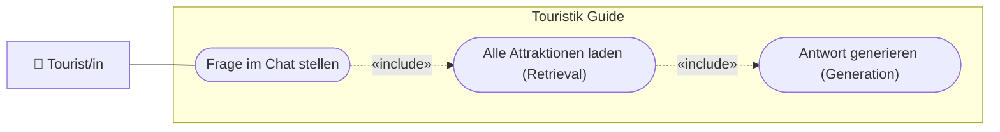

# USERSTORY.md — Nutzeranforderungen: 11-ki-chat-assistent

> **Hinweis:** Konkretes LB3-Feature, **optionale Aufgabe D3** (Musterlösung, Stufe D —
> `sendDataToN8N('chat')` in `assets/js/n8n.js`, Modal „Frag den AI-ttraktionsbot").
> Ursprünglich als Test gedacht, inzwischen produktiv — zeigt, dass ein Chatbot (RAG-
> Muster) auch in einem kleinen Beispiel sinnvoll sein kann.

---

## Story 1 — Frei nach Attraktionen fragen statt Liste durchsuchen

**Als** Tourist/in vor Ort
**möchte ich** in natürlicher Sprache fragen können, welche Attraktion zu meinem
Interesse passt
**damit** ich nicht die ganze Liste durchsuchen muss, um die richtige zu finden.

### Abnahmekriterien

- Im Chat-Modal kann eine freie Frage eingegeben werden (z. B. „Wo kann ich schwimmen?")
- Die Antwort bezieht sich auf reale Attraktionen aus `Attractions`, nicht auf erfundene
- Findet der Assistent keine passende Attraktion, sagt er das ehrlich statt zu erfinden

---

## UseCase-Diagramm (UCD)

> Konvention: [`docs/diagramme.md`](../../docs/diagramme.md) (Abschnitt 1).

---

> **Einordnung:** Wie bei `10-ki-attraktion-erstellen` ist die PWA-Seite (Modal
> `modalChat`, Button `btnChat` → `sendDataToN8N('chat')`) bereits fertig implementiert —
> die Lernaufgabe liegt im n8n-Backend (einfaches RAG: alle Zeilen laden, aggregieren,
> als Kontext ans LLM geben).
